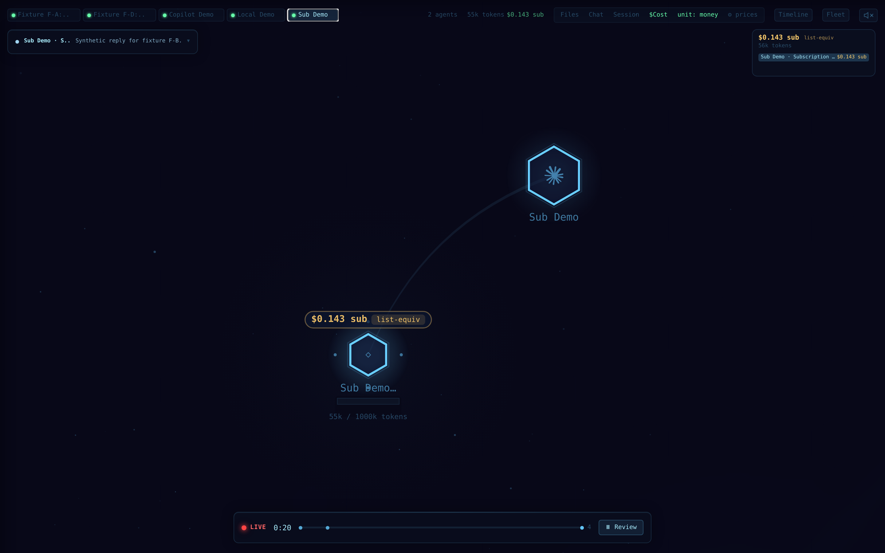
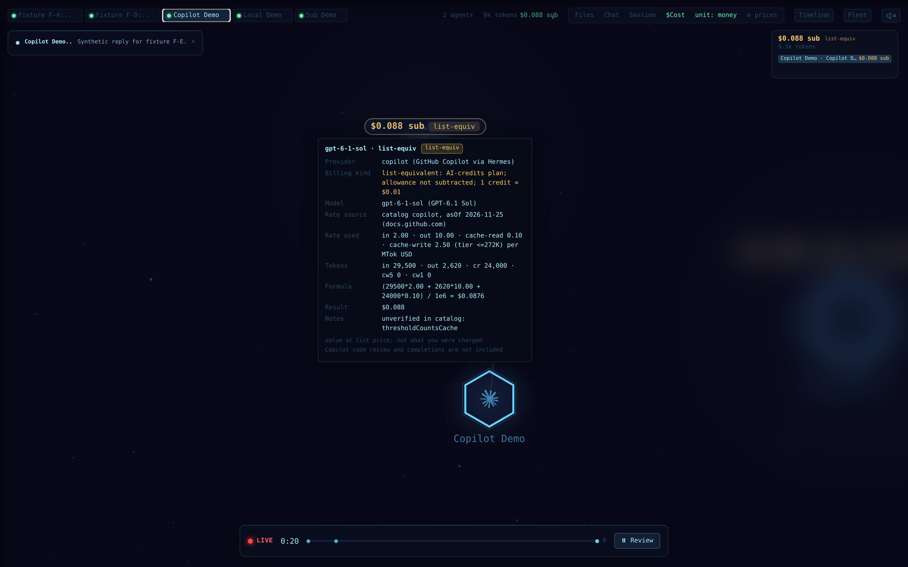
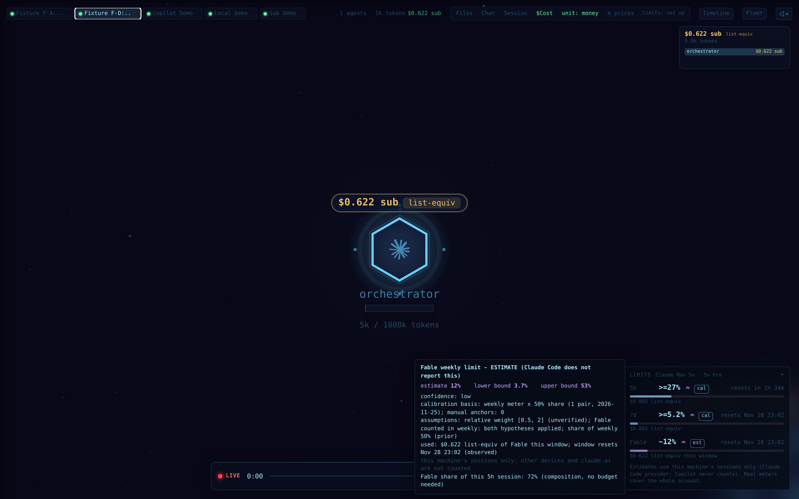
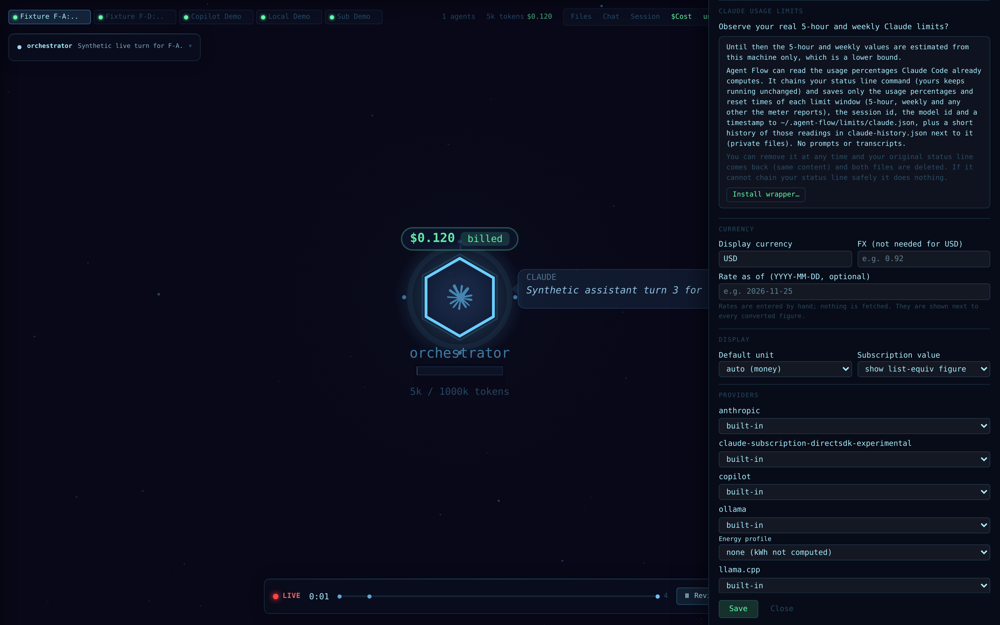

# Agent Flow

Real-time visualization of Claude Code and Codex agent orchestration. Watch your agents think, branch, and coordinate as they work. [Demo video here](https://www.youtube.com/watch?v=Ud6eDrFN-TA). 


## Why Agent Flow?

I built Agent Flow while developing [Antics](https://antics.gg), a game creation platform driven by AI agents. Debugging agent behavior was painful, so we made it visual. Now we're sharing it.

Claude Code is powerful, but its execution is a black box — you see the final result, not the journey. Agent Flow makes the invisible visible:

- **Understand agent behavior** — See how Claude breaks down problems, which tools it reaches for, and how subagents coordinate
- **Debug tool call chains** — When something goes wrong, trace the exact sequence of decisions and tool calls that led there
- **See where time is spent** — Identify slow tool calls, unnecessary branching, or redundant work at a glance
- **Learn by watching** — Build intuition for how to write better prompts by observing how Claude interprets and executes them

Running many sessions at once? Agent Flow pairs with [Ravenry](https://patoles.github.io/ravenry/): Agent Flow shows what one session is doing inside, Ravenry puts all your Claude Code and Codex sessions on one board, shows which one needs you, and lets you answer from your phone.

## Features

- **Live agent visualization**: Watch agent execution as an interactive node graph with real-time tool calls, branching, and return flows
- **Claude Code + Codex**: Auto-detects sessions from both runtimes concurrently and shows them side-by-side, or restrict to one via the `agentVisualizer.runtime` setting
- **Claude Code hooks**: Lightweight HTTP hook server receives events directly from Claude Code for zero-latency streaming
- **Codex rollout tailing**: Reads `~/.codex/sessions/**/rollout-*.jsonl` (respects `CODEX_HOME`) and surfaces tool calls, reasoning, and authoritative token counts from Codex's own event stream
- **Multi-session support**: Track multiple concurrent agent sessions with tabs
- **Interactive canvas**: Pan, zoom, click agents and tool calls to inspect details
- **Timeline & transcript panels**: Review the full execution timeline, file attention heatmap, and message transcript
- **JSONL log file support**: Point at any JSONL event log to replay or watch agent activity

## Getting Started

### Quick Start (no VS Code required)

```bash
npx agent-flow-app
```

This starts the visualizer in your browser. Start a Claude Code session in another terminal — events will stream in real-time.

Options:
- `--port <number>` — change the server port (default: 3001)
- `--no-open` — don't open the browser automatically
- `--verbose` — show detailed event logs
- `--anonymize-content[=<all|none|profile,profile>]` — show structure only instead of content (see below). A bare flag means `all`.
- `--show-content` — same as `--anonymize-content=none`

#### Live Hermes feed: full text, and anonymizing it per profile

For Hermes profiles the relay reads each session's messages from the profile's `state.db` (**read-only**: opened with `readOnly` and `PRAGMA query_only`, SELECT only, nothing is ever written to Hermes) and shows the full user and assistant text, the full Bash command, edit diffs (old and new text), write contents and tool results. If `state.db` or the session can't be read, the feed falls back to what `agent.log` offers (tool name and duration only). Strings that look like secrets (API keys, tokens, `Bearer …`, `password=…`, URL credentials, private keys) are redacted from everything shown, whatever the setting below.

Only item counts and one huge-text guard are capped (memory protection): `MAX_EVENT_LOG`, `MAX_CONVERSATION_MESSAGES` and `MAX_BUBBLES` in `web/hooks/simulation/types.ts`, the relay's `MAX_EVENT_BUFFER`, `MAX_MARKERS_PER_INSTANCE` (300 timeline markers per agent in the Fleet tab, `web/lib/fleet/fleet-model.ts`), `BACKLOG_MAX_ROWS` (300, the rows replayed on a session's first read) and `BATCH_MAX_ROWS` (500, the rows per later read) in `scripts/hermes-transcript.ts`, and `AGENT_FLOW_MAX_TEXT_CHARS` (default 200000 characters per text field, `0` = off).

To show **structure only** for some or all profiles — command name and length instead of the command, file path and line counts instead of a diff, role / sender / platform and length instead of a message body, size instead of a tool result, and task id and length instead of a Kanban task title in the Fleet tab — set, when the relay starts:

| Setting | Meaning |
|---|---|
| `AGENT_FLOW_ANONYMIZE_CONTENT=all` | anonymize every profile |
| `AGENT_FLOW_ANONYMIZE_CONTENT=none` | full content for every profile |
| `AGENT_FLOW_ANONYMIZE_CONTENT=hestia,sophia` | anonymize only the listed Hermes profiles |
| `--anonymize-content=<value>` / `--show-content` | same values as flags; a flag wins over the environment variable |
| `AGENT_FLOW_ANONYMIZE_OVERRIDES=hestia=on,sophia=off` | per-profile override, wins over everything above (relay option `anonymizeOverrides` does the same in code) |

Profiles the setting does not name follow the default, which is **`none`** (full content) — one constant, `DEFAULT_ANONYMIZE` in `web/lib/content-privacy.ts`. A name that is not a Hermes profile on this machine is ignored with a warning in the relay log; the relay still starts. The live feed, the session detail and the Fleet tab all follow the same per-profile setting, and anonymizing happens in the relay, so the hidden text never reaches the browser.

**Idle profiles.** The relay's session list includes every Hermes profile with a session in the last 24 hours, marked `idle: true` when nothing has logged since the relay started (read-only `SELECT` on each profile's `state.db`, up to 20 sessions per profile). Idle profiles appear on the Fleet node map and timeline but never as tabs. `AGENT_FLOW_FLEET_IDLE_WINDOW_HOURS` sets the window (fractions allowed, `0` = live activity only).

**Fleet node map.** With Fleet on, the canvas draws every profile (live and idle) as a node with its sessions around it, plus Kanban boards (squares) and Supermemory namespaces (diamonds), linked to the profiles that use them. It is built from all listed sessions, independent of the open tab. At most 8 sessions per profile and 8 boards / 8 namespaces are drawn; archived and empty boards are skipped.

The Fleet tab reads Hermes Kanban boards and Supermemory namespaces (read-only) from `GET /api/fleet`. The endpoint is loopback-only by default: requests with a non-loopback `Host` or proxy headers (`X-Forwarded-For`, `X-Real-IP`, `Forwarded`) get `403`. To serve it through a reverse proxy or to other machines, set `AGENT_FLOW_FLEET_ALLOW_REMOTE=1` — this exposes board names, task titles and namespace names to anyone who can reach the port, so only use it on a trusted network. The response never contains filesystem paths: the Kanban database path is dropped and scrubbed from board error messages.

#### Which build is running

Every build records the git branch and commit it was built from (`git rev-parse --abbrev-ref HEAD` / `git rev-parse HEAD` in the repository root; `AGENT_FLOW_BUILD_BRANCH` and `AGENT_FLOW_BUILD_COMMIT` override them, e.g. when building from a tarball; unknown values are `unknown`). `pnpm run build:app` bakes them into `app/dist/app.js`, and `pnpm run build:web` into the Next.js page. They show up in:

- the page: `<meta name="build-branch" content="…">` and `<meta name="build-commit" content="…">` in the HTML head;
- the relay: `GET /health` returns `{"status":"ok","branch":"…","commit":"…"}`. It has the same loopback `Host` check as every other route (a foreign `Host` gets `403`).

```bash
curl -s http://127.0.0.1:3001/health
curl -s http://127.0.0.1:3001/ | grep -o '<meta name="build-[a-z]*" content="[^"]*">'
```

### Standalone Web App (from source)

```bash
git clone https://github.com/patoles/agent-flow.git
cd agent-flow
pnpm i
pnpm run setup      # configure Claude Code hooks (one-time)
pnpm run dev        # start the web app + event relay
```

Open http://localhost:3000 and start a Claude Code session in another terminal — events will stream to the browser in real-time.

### VS Code Extension

1. Install the extension
2. Open the Command Palette (`Cmd+Shift+P`) and run **Agent Flow: Open Agent Flow**
3. Start a Claude Code or Codex session in your workspace — Agent Flow will auto-detect it

Agent Flow automatically configures Claude Code hooks the first time you open the panel. To manually reconfigure, run **Agent Flow: Configure Claude Code Hooks** from the Command Palette.

### Runtime selection

By default Agent Flow watches both Claude Code (`~/.claude/projects/`) and Codex (`~/.codex/sessions/`) concurrently in all three entry points (VS Code extension, `pnpm run dev`, `npx agent-flow-app`). Sessions are shown side-by-side and tagged by runtime. If you only use one, the other is a harmless no-op — no visible effect, no user action needed.

To restrict to one runtime:

- **VS Code extension:** set `agentVisualizer.runtime` to `"auto"` / `"claude"` / `"codex"` in your settings
- **`pnpm run dev` and `npx agent-flow-app`:** set the `AGENT_FLOW_RUNTIME` environment variable to `claude` or `codex` (defaults to watching both)

For non-default Codex installs, set the `CODEX_HOME` environment variable.

### JSONL Event Log

You can also point Agent Flow at a JSONL event log file:

1. Set `agentVisualizer.eventLogPath` in your VS Code settings to the path of a `.jsonl` file
2. Agent Flow will tail the file and visualize events as they arrive

## Commands

| Command | Description |
|---------|-------------|
| `Agent Flow: Open Agent Flow` | Open the visualizer panel |
| `Agent Flow: Open Agent Flow to Side` | Open in a side editor column |
| `Agent Flow: Connect to Running Agent` | Manually connect to an agent session |
| `Agent Flow: Configure Claude Code Hooks` | Set up Claude Code hooks for live streaming |
| `Agent Flow: Open Costs Config (~/.agent-flow/costs.json)` | Open (and create, if missing) the costs config, see [Configurable costs](#configurable-costs) |
| `Agent Flow: Configure Claude statusLine (observe usage limits)` | Opt-in: chain a small wrapper onto your Claude Code status line to observe the 5-hour and weekly limits |
| `Agent Flow: Remove Claude statusLine wrapper` | Undo the wrapper and restore your own status line |

## Keyboard Shortcut

| Shortcut | Action |
|----------|--------|
| `Cmd+Alt+A` (Mac) / `Ctrl+Alt+A` (Win/Linux) | Open Agent Flow |

## Settings

| Setting | Default | Description |
|---------|---------|-------------|
| `agentVisualizer.runtime` | `"auto"` | Which agent runtime(s) to watch: `"auto"` (both), `"claude"`, or `"codex"` |
| `agentVisualizer.devServerPort` | `0` | Development server port (0 = production mode) |
| `agentVisualizer.eventLogPath` | `""` | Path to a JSONL event log file to watch |
| `agentVisualizer.autoOpen` | `false` | Auto-open when an agent session starts |
| `agentVisualizer.costs.enabled` | `true` | Use the costs config files. Off: built-in prices only |
| `agentVisualizer.costs.configPath` | `""` | Absolute path (or `~/…`) of the costs file instead of `~/.agent-flow/costs.json`. Machine-scoped |
| `agentVisualizer.costs.displayCurrency` | `""` | Currency code to show costs in, e.g. `EUR` (needs `currency.fx` in the costs file) |
| `agentVisualizer.costs.unit` | `""` | `auto`, `money`, `kwh` or `tokens` |
| `agentVisualizer.costs.unknownModelPolicy` | `""` | `provider-default`, `unpriced` or `zero` for a model without a price |

The four `costs.*` value settings are scalars only and lose against the costs file. Everything else (rates, energy, limits) lives in the file, see below.

## Configurable costs

The cost overlay (the **$Cost** button) prices each agent from its reported token usage. This section says where the prices come from, what each number means, and how to change them. Plan limits are covered at the end.

[](docs/screenshots/t_a46b5d1e/03-overlay-subscription-listequiv-desktop.png)

*Fixture data, not a real session: a subscription agent shown as `$0.143 sub` with the `list-equiv` badge, and the summary panel at the top right.*

### What a number means

Every figure is one of four kinds, and the hover tooltip (tap on a phone) says which:

| Kind | Pill | Meaning |
|---|---|---|
| billed | `$0.012` | Usage reported by the API, times your configured API rate. Check it against your invoice. |
| list-equivalent | `$0.012 sub` + `list-equiv` badge | Usage reported by a subscription or credits provider, valued at list price. **Not what you were charged.** |
| estimated | `~$0.012` | No reported usage, a local model priced from configured power, or a fallback rate for an unknown model. Order of magnitude only. |
| unpriced | `?` | No rate is configured for this model. |

The summary panel adds up each kind separately; kinds are never summed together. The tooltip names the provider, the kind with its reason, the model, the rate source (your rule, your provider rate, or the built-in catalog with its `asOf` date and host), the rate used, the token counts, the formula with the numbers filled in, and the result.

[](docs/screenshots/t_a46b5d1e/09-tooltip-copilot-desktop-hover.png)

*Fixture data: hover on a Copilot agent. It reads `list-equivalent: AI-credits plan; allowance not subtracted; 1 credit = $0.01`, the rate source `catalog copilot, asOf 2026-11-25 (docs.github.com)`, the formula, and the footnotes `value at list price; not what you were charged` and `Copilot code review and completions are not included`.*

### Providers

| Provider | Where its usage comes from | Default kind |
|---|---|---|
| Claude Code (`anthropic`) | session transcripts, which do not say whether you pay per token or by subscription | **you set `billing`**: `api` gives *billed*, `subscription` gives *list-equivalent* |
| Claude via Hermes (`claude-subscription-directsdk-experimental`) | the Hermes `agent.log` `provider=` field | list-equivalent |
| GitHub Copilot via Hermes (`copilot`) | Hermes `agent.log` lines with `provider=copilot` | list-equivalent (AI credits, 1 credit = $0.01) |
| Local runtimes (ollama, llama.cpp, vLLM, LM Studio, custom OpenAI-compatible) | Hermes `provider=` value | estimated, from configured watts; money comes only from electricity |
| Anything else | Hermes `provider=` value | estimated, with the `pricing.unknownModel` policy |

**Copilot caveats.** Agent Flow only sees Copilot calls routed through Hermes. Direct Copilot CLI or VS Code Copilot Chat usage has no token source it can read, so it is not counted. The figure is list price for the tokens seen. Your plan's monthly credit allowance is not subtracted, and it is not your GitHub bill. Code completions are not billed in credits and code review is not priced. For Copilot Claude models the cost can include an inferred cache write on uncached input of 1,024 tokens or more when no write is reported (`implicitCacheWrite`, on by default); this inference has not been checked against a GitHub invoice, and the tooltip says when it was applied. Codex is not covered: Codex agents keep the `~` estimate path.

**Local models** are not measured, and local-runtime support so far is verified against fixture data only (no local-runtime `provider=` line was found in the Hermes logs on the development host).

### The config file

`~/.agent-flow/costs.json` is the source of truth. Layers, highest first:

1. `<workspace>/.agent-flow/costs.json`, a project override
2. the user file `~/.agent-flow/costs.json` (location override: setting `agentVisualizer.costs.configPath`, else the environment variable `AGENT_FLOW_COSTS`)
3. the four `agentVisualizer.costs.*` scalar settings
4. the built-in catalog (Anthropic and Copilot price sheets, each row with a source URL and `asOf` date; updated with releases only, never fetched at runtime)

For a given model the first hit wins: a matching `pricing.models[]` rule (most specific match, ties go to the earlier rule), then your `pricing.providers.<id>` rate, then the catalog row for that model, then the provider's catalog default, then `pricing.unknownModel.policy`. Rules match with `*` and `?` globs, not regular expressions.

The file reloads while Agent Flow runs. A file that does not parse or fails validation keeps the last good config for pricing, and the error banner lists every problem with its JSON pointer. Unknown keys are warnings. The file is capped at 256 KB. A project file cannot set `configPath`, and it is read only if it resolves inside the workspace's `.agent-flow/` directory. Files are written atomically with mode `0600`.

Rates are USD per million tokens unless the rule names a `currency`. There is no live exchange rate: for a non-USD display currency you type `currency.fx` (units of that currency per 1 USD) and its date `fxAsOf`, and the tooltip shows both.

A complete example, [docs/examples/costs.example.json](docs/examples/costs.example.json) (invented values for illustration; the prices, wattages, tariff and anchor are not recommendations):

```json
{
  "schemaVersion": 1,
  "currency": {
    "display": "EUR",
    "fx": { "EUR": 0.92 },
    "fxAsOf": "2026-11-25"
  },
  "display": {
    "unit": "auto",
    "decimals": "auto",
    "subscriptionValue": "show"
  },
  "pricing": {
    "multiplier": 1,
    "unknownModel": {
      "policy": "global-rate",
      "globalRate": { "input": 3, "output": 15 }
    },
    "providers": {
      "anthropic": { "billing": "subscription" },
      "copilot": { "billing": "credits", "implicitCacheWrite": true },
      "ollama": { "billing": "local", "energyProfile": "workstation-gpu" }
    },
    "models": [
      {
        "match": { "model": "acme-xyz-*" },
        "rate": { "input": 1.5, "output": 6, "cacheRead": 0.15 }
      },
      {
        "match": { "model": "acme-long-*" },
        "tiers": [
          { "maxPromptTokens": 200000, "rate": { "input": 3, "output": 15 } },
          { "rate": { "input": 6, "output": 22.5 } }
        ]
      },
      {
        "match": { "provider": "ollama", "model": "llama3*" },
        "energyProfile": "workstation-gpu"
      }
    ]
  },
  "energy": {
    "profiles": {
      "workstation-gpu": {
        "powerW": { "idle": 45, "load": 320 },
        "throughput": { "genTokPerSec": 40, "prefillTokPerSec": 800 },
        "pue": 1,
        "attribution": "marginal"
      }
    },
    "tariff": {
      "currency": "EUR",
      "flatPerKWh": 0.18,
      "timeOfDay": [
        {
          "days": ["mon", "tue", "wed", "thu", "fri"],
          "from": "22:00",
          "to": "06:00",
          "perKWh": 0.1
        }
      ],
      "tz": "Europe/Zagreb"
    }
  },
  "limits": {
    "claude": {
      "plan": "max5x",
      "weekly": {
        "resetsAt": { "dow": "thu", "time": "09:00", "tz": "Europe/Zagreb" }
      },
      "fable": {
        "enabled": true,
        "shareOfWeekly": { "lo": 0.5, "point": 0.5, "hi": 0.5 },
        "relativeWeight": { "lo": 0.5, "hi": 2 },
        "anchors": [{ "at": "2026-11-24T18:00:00Z", "observedPct": 1.5 }]
      }
    }
  }
}
```

Tiers use fixed prompt-size boundaries: `maxPromptTokens` must be 100000, 200000 or 272000, strictly increasing, and only the last tier omits it. Any other value is a validation error rather than a silent mis-price.

**Editor support.** [extension/costs.schema.json](extension/costs.schema.json) is a JSON Schema for autocomplete; the extension maps it to any `**/.agent-flow/costs.json`. It is for editing help only. The validator in `web/lib/costs/validate.ts` is authoritative (for example, unknown keys are warnings there), and a test in `extension/test/costs-schema.test.ts` fails if the two drift apart.

**Editing in the app.** The **⚙ prices** button opens the settings drawer (providers, model rules, energy profile and tariff, limits). It writes the same file, with inline errors, and refuses to overwrite a file that changed on disk after it was loaded. The header **unit** button cycles money, kWh and tokens. `display.subscriptionValue: "hide"` hides list-equivalent money and totals and shows token counts instead.

### Local models and energy

For a local model, money is electricity only: kWh x tariff. Energy is **estimated from the watts you configure, not measured**. With the default `marginal` attribution a call is charged `(P_load - P_idle)` over its busy time (set `"attribution": "total"` for the full load power, and `pue` for facility overhead). Busy time comes from the logged latency, or from your `throughput` figures when latency is missing; time spent in tool execution is excluded. Overlapping calls share the busy time, so the total is conserved. A time-of-day tariff prices each part of a call at the rate of the hour it ran in, in the tariff's `tz`. No hardware presets ship; measure your own idle and load power. Worked example: `(320 - 45) W x 36 s = 9,900 J = 0.00275 kWh`.

### Usage limits and the Fable estimate

> **Plan limits are not officially published as token or dollar amounts.** Anthropic can change them at any time. Treat every limit figure that is not tagged `obs` as an estimate.

Claude plan limits appear in a LIMITS panel with up to three rows (5h, 7d, Fable), depending on `limits.claude.plan`. `max5x` and `custom` can show all three. `ultra` has no 5h row unless Claude Code reports one, and `pro` has 5h and 7d but no Fable row. Plan `api` (pay per token) shows no panel. With no plan set, the panel appears only once a reading has been observed. Each row says where it comes from:

| Tag | Meaning |
|---|---|
| `obs` | **Observed**: the number Claude Code itself reported for the 5-hour or weekly window (requires the statusLine opt-in below). Shown with the reset time. |
| `stale` | An observed reading older than 10 minutes. The panel shows `as of HH:MM`. |
| `cal` | Estimated from your local usage, calibrated against earlier observed readings. |
| `est` | Estimated, with no calibration. Prefix `~` is an estimate, `>=` a lower bound (this machine's sessions only). |

Estimates count this machine's sessions and the list-equivalent value of the tokens, so other devices and claude.ai are not included. Only providers listed in `limits.claude.countProviders` count; Copilot never does.

**Fable.** In a spike on this project, Claude Code's status line carried only `five_hour` and `seven_day`, and no Fable or per-model window ([docs/spikes/S1-claude-limits.md](docs/spikes/S1-claude-limits.md), two live samples). So the Fable weekly limit can only be **estimated**, and it is:

- The Fable row appears only when Fable was used in the current weekly window. Otherwise you see the 5h and weekly rows.
- The row carries the estimate icon `≈` and a point value. Values under 1% are shown in per-mille (`‰`), for example `3.4‰`.
- Hovering (tap on a phone) shows the lower and upper bound, a confidence tag (`low`, `medium`, `high`), the calibration basis (manual anchors, the weekly meter times a share, or a typed budget), and the assumptions. The assumptions are priors that nothing has verified: Fable's share of the weekly limit, its weight relative to other models (`relativeWeight`, default 0.5 to 2), and whether the observed weekly number already includes Fable (both cases are computed and the bounds cover both).
- Confidence is capped at `low` when the estimate rests on the weekly meter and the assumed share. Typing readings from claude.ai into `limits.claude.fable.anchors` is the strongest basis.

[](docs/screenshots/t_bd6ae976/12-fable-tooltip-weekly-meter-desktop-hover.png)

*Fixture data: the LIMITS panel with `5h >=27% ≈ cal`, `7d >=5.2% ≈ cal`, `Fable ~12% ≈ est`, and the Fable tooltip: `estimate 12%`, `lower bound 3.7%`, `upper bound 53%`, `confidence: low`, `calibration basis: weekly meter x 50% share (1 pair, 2026-11-25); manual anchors: 0`.*

### Observing the real limits: the statusLine opt-in

Observed 5h and weekly values need one change to your own Claude Code setup, so it is **off until you ask for it**: run **Agent Flow: Configure Claude statusLine (observe usage limits)** (the cost settings drawer has the same opt-in under **Claude usage limits**, with an **Install wrapper…** button).

What it does:

- It edits `~/.claude/settings.json` only, never project or managed settings. It sets `statusLine.command` to `sh "~/.claude/agent-flow/statusline-run.sh"`, a small launcher that finds node on every run (the node path recorded in `~/.agent-flow/node-path`, then `PATH`, then `~/.hermes/tools/node-*`, volta, nvm and the usual system directories) and starts the wrapper script (`~/.claude/agent-flow/statusline-shim.js`) with your input unchanged. A node upgrade or move therefore does not stop the readings, and the launcher updates `node-path` by itself. If it finds no node, it prints nothing, exits 0 and leaves `~/.agent-flow/limits/node-missing.json`; the LIMITS panel and the chip then say "the wrapper cannot find node" instead of just ageing into `as of HH:MM`, and limits stay estimated. On Windows the command keeps the absolute node path (no `sh`).
- **It chains your existing status line.** The wrapper runs your original command with the same input, environment and working directory, and passes its output and exit code through unchanged. Your original `statusLine` object is saved unmodified in `~/.agent-flow/statusline-original.json`. If you had none, the wrapper shows nothing.
- **It refuses to install, and changes nothing, when it cannot chain safely:** the file is not valid JSON, `statusLine` is not a command, the command is empty or very long, an organisation-managed settings file sets a `statusLine`, or the node path is unusable. Limits then stay estimated.
- The wrapper saves only the numbers of each limit window the meter reports (`used_percentage` and `resets_at`; today the 5-hour and weekly windows, and any other window Claude Code adds), the session id, the model id and a timestamp to `~/.agent-flow/limits/claude.json` (mode `0600`). The extension itself, not the wrapper, then appends a short history of the 5-hour and weekly readings (time, used percentage, reset time; no session or model id; about 30 days at most) to `~/.agent-flow/limits/claude-history.json` (also `0600`); the estimates are calibrated from it. No prompt text, transcript path, working directory or credentials. Any failure in the wrapper is swallowed, so Agent Flow cannot break your status line.
- Before writing, it copies `settings.json` to `settings.json.agent-flow.bak`. A symlinked `settings.json` (stow, chezmoi, home-manager) is written through, so the link stays a link. Running it twice does nothing.
- A project's own `statusLine` overrides user settings inside that project, so limits may not be observed there; Agent Flow warns about it.
- **Installed before this launcher existed?** The old command was `"<absolute node path>" "<shim>"`; it keeps working until that node path moves, then fails silently. The drawer shows it as **installed (legacy command)** with an **Upgrade wrapper…** button; running **Configure Claude statusLine** again does the same. The upgrade changes only the command in `statusLine` (every other field, the saved original and the backup stay) and adds the launcher and `node-path`.

**To undo it:** run **Agent Flow: Remove Claude statusLine wrapper**. It puts your original `statusLine` back (same content, the file may be re-indented) and deletes the wrapper, the launcher, the recorded node path, the node-missing marker, the saved original, the limits and history files and the backup. If you edited the wrapped `statusLine` entry after installing, the command refuses and changes nothing; if your `statusLine` no longer points at the wrapper, it is left as it is and only Agent Flow's own files are removed. Uninstalling the extension runs the same restore (`extension/scripts/uninstall.js`); when the wrapped entry was edited it keeps your edits and swaps only the wrapper command back to your original. If automatic removal is refused, set `statusLine` back by hand from `~/.agent-flow/statusline-original.json`, or delete the key if the file says there was none.

[](docs/screenshots/t_2d06cee0/01-optin-drawer-desktop.png)

*Fixture data: the cost settings drawer before anything is installed. The opt-in text under **Claude usage limits** says what is saved, that it can be removed at any time, and that nothing is changed if the status line cannot be chained safely; below it are the currency, display and provider settings.*

### Privacy

Costs are computed locally from files on your machine. Agent Flow does not fetch prices, exchange rates or limits from the network for this feature, and does not read any credential. The config, the limits file and their backups are written with mode `0600`. Everything stored by the statusLine wrapper is listed above.

## Requirements

- [Node.js](https://nodejs.org/) 20+ (LTS recommended)
- [pnpm](https://pnpm.io/)
- Claude Code CLI
- For the VS Code extension: a VSCode-compatible IDE 1.85+ (e.g. [VS Code](https://code.visualstudio.com/), [Cursor](https://cursor.sh/), [Windsurf](https://windsurf.com/))

## Development

```bash
pnpm i              # install dependencies for all packages
pnpm run setup      # configure Claude Code hooks (one-time)
pnpm run dev        # start dev server + event relay
```

`pnpm run dev` starts both the Next.js dev server and an event relay that receives Claude Code events and streams them to the browser via SSE.

Other scripts:

| Script | Description |
|--------|-------------|
| `pnpm run dev:demo` | Start with demo/mock data |
| `pnpm run dev:relay` | Run the event relay server standalone |
| `pnpm run dev:extension` | Watch-build the extension |
| `pnpm run build:all` | Production build (webview + extension) |
| `pnpm run build:web` | Build the Next.js web app |
| `pnpm run build:extension` | Build the extension |
| `pnpm run build:webview` | Build the webview assets |

## Star History

[](https://www.star-history.com/?repos=patoles%2Fagent-flow&type=date&legend=bottom-right)


## Author

Created by [Simon Patole](https://github.com/patoles), for [Antics](https://antics.gg). Also by me: [Ravenry](https://patoles.github.io/ravenry/), one board for all your agent sessions.

Want an MCP server for your product, or Claude Code set up for your team? [Work with me](https://simonpatole.com).

## Privacy & Telemetry

Agent Flow ships **opt-out** anonymous usage telemetry, enabled by default only
in the published `npx agent-flow-app` binary. `pnpm run dev` and the VS Code
extension emit nothing. Only aggregate events are sent — session count,
duration, event count, OS/arch, Agent Flow version, distinct model IDs
observed, which runtimes were watched, and error class names. Prompts, file
paths, tool calls, user info, and environment variables are never sent.

- **Turn off:** `export AGENT_FLOW_TELEMETRY=false` or `export DO_NOT_TRACK=1`
  (disabled installs write zero state to disk — no `~/.agent-flow/` directory)
- **Inspect the payload:** `cat ~/.agent-flow/telemetry/events.jsonl`
- **Full schema + exact fields:** see the v0.8.1 entry in
  [extension/CHANGELOG.md](extension/CHANGELOG.md) or the `serialize()` function
  in [scripts/telemetry.ts](scripts/telemetry.ts)
- **Reset your anonymous identity:** delete `~/.agent-flow/installation-id` —
  a fresh random UUIDv4 will be generated on next run


## License

Apache 2.0 — see [LICENSE](LICENSE) for details.

The name "Agent Flow" and associated logos are trademarks of Simon Patole. See [TRADEMARK.md](TRADEMARK.md) for usage guidelines.
